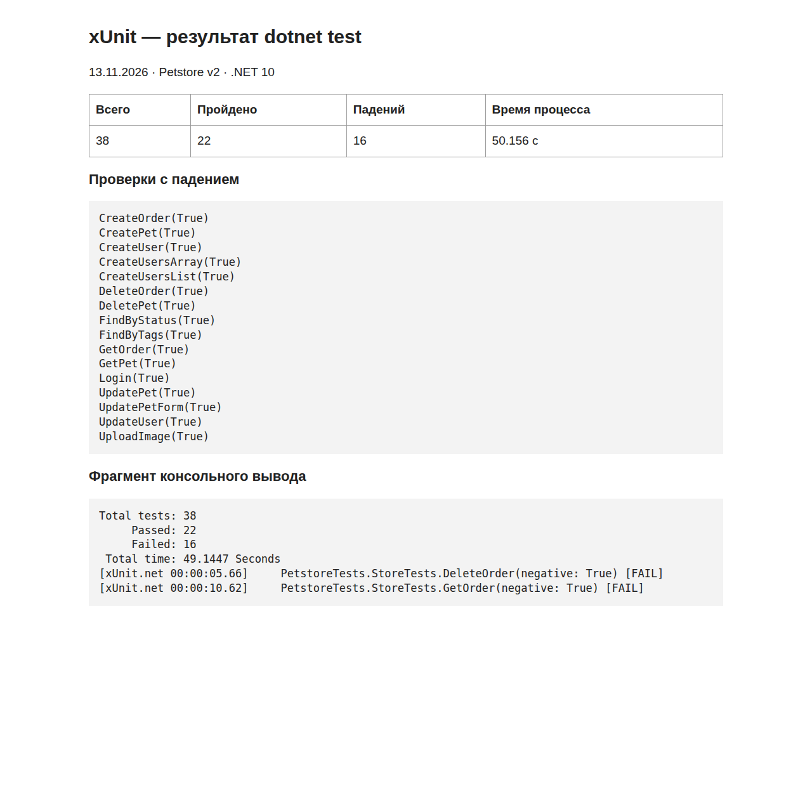
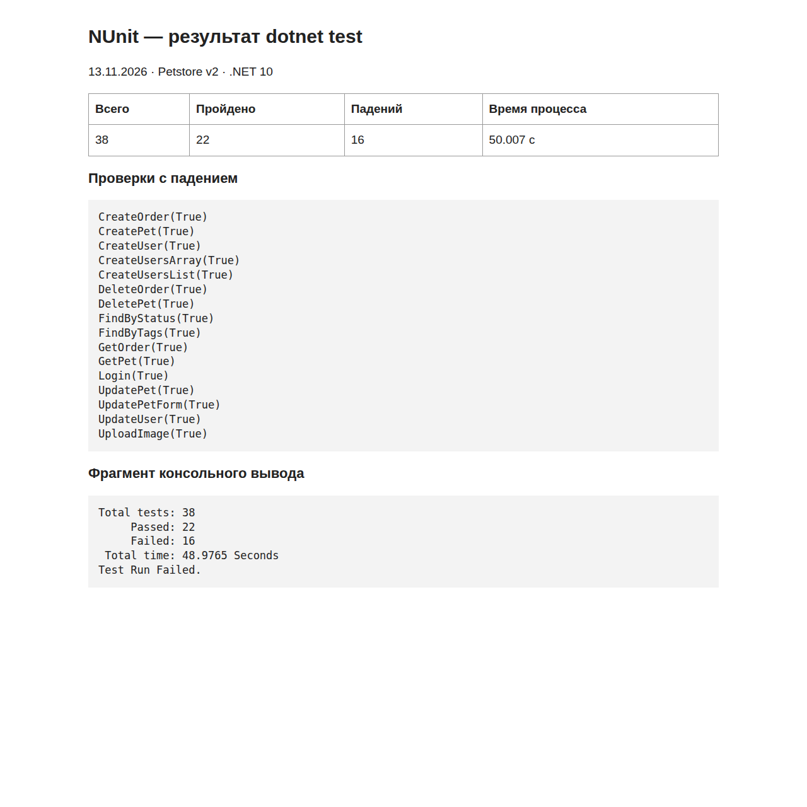

# КТ №8. Анализ результатов тестирования

Григорьев Лаврентий Андреевич, группа 3П3.24.NET. Вариант .NET: xUnit и NUnit.

Проверяется Swagger Petstore v2: https://petstore.swagger.io/v2. В каждом проекте 38 API-тестов для pet, store и user: 20 позитивных и 18 негативных. Для каждой операции с позитивным и негативным случаем используется параметризация.

## Запуск

Нужен .NET SDK 10. Из корня репозитория:

```bash
dotnet test xunit-tests/Petstore.XUnit.csproj
dotnet test nunit-tests/Petstore.NUnit.csproj
```

Команды запускают по очереди: проекты используют общий публичный сервер. Для повторения замера сначала выполнить dotnet build каждого проекта, затем из соответствующей папки:

```bash
dotnet test --no-build --no-restore --logger "trx;LogFileName=run.trx" --logger "console;verbosity=normal" --results-directory results
```

API-тесты создают уникальные имена пользователей и ID питомцев. Заказы используют свободные ID 1–10. После теста свои записи удаляются; перед удалением проверяются ID и имя пользователя, имя питомца или petId заказа. Чужая запись не удаляется. Публичный сервер может быть изменён другими пользователями между проверкой свободного ID и созданием заказа; результаты повторного запуска могут отличаться.

## Результаты

Запуск 13.11.2026: xUnit — 22 passed, 16 failed; NUnit — 22 passed, 16 failed. Все 20 позитивных сценариев прошли в каждом наборе. Пропусков нет. Код завершения dotnet test — 1, поскольку часть проверок не прошла. Ожидаемые и полученные статусы приведены в анализе.

Скриншоты ниже сделаны в браузере: показана сводка из настоящих TRX-файлов и фрагмент консольного вывода dotnet test. Полные журналы приложены в папках results; изображения не являются снимками окна терминала.

### xUnit



### NUnit



## Файлы

- xunit-tests/ — клиент, фикстура и тесты xUnit.
- nunit-tests/ — такой же набор для NUnit.
- [Анализ №1 и №2](Анализ.md).
- [Ответы на контрольные вопросы](<Контрольные вопросы.md>).
- screenshots/ — изображения результатов.

В проектах используется один и тот же HTTP-клиент и одинаковые тела тестов. Различаются атрибуты, assert и подготовка/очистка. Утилиты повторения запросов до успешного ответа, xfail и скрытые пропуски не используются.
